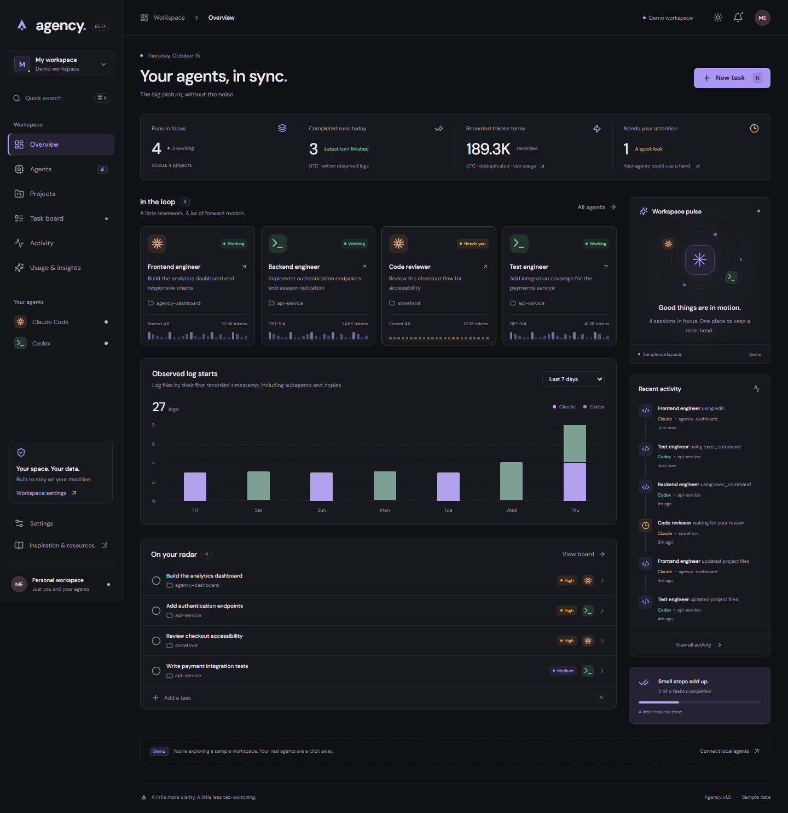

# Agency

A local workspace for keeping track of Claude Code and Codex. Sessions, a task board, recent activity, and recorded token usage in one responsive dashboard.



[Mobile preview](docs/screenshots/mobile.png)

## Run

Requires Node.js 22+ and npm.

```sh
npm install
npm run dev
```

Open **http://127.0.0.1:5173**. The API runs on port 4318. New workspaces default to **Local workspace**, reading your own logs. Existing workspace preferences are respected. Choose **My workspace → Demo workspace** to explicitly explore sample data.

For a production build with one local server:

```sh
npm run build
npm start
```

Open **http://127.0.0.1:4318**. Fonts and assets are bundled locally. No API keys, cloud account, or database service are required.

## What works

- Overview with active sessions, attention items, recorded tokens, session activity, and task progress.
- Agent session cards and table, provider/status filters, project search, and inspectable event history.
- Project workspaces group observed sessions and planned tasks, with project search, recent activity, task progress, and project-scoped task creation.
- Task creation, editing, provider assignment, priorities, status changes, completion, and deletion.
- Task-board priority filtering and explicit stored/priority/recent ordering. Filtering and sorting do not rewrite tasks; reset restores the default stored order.
- Session-linked follow-up tasks, with navigation from task to session and linked tasks inside session details. Change or remove a link in the task editor.
- Activity feed, provider usage breakdown, and project summaries.
- **Usage & insights** shows input/output, cache-read/cache-write, reported reasoning, dated UTC usage, per-log coverage, model context snapshots, provider quota snapshots, and native CLI cost estimates where available.
- **Export CSV** downloads the selected usage providers and period locally, with deduplicated summaries, dated records, source timestamps, and coverage caveats. Unknown values remain distinct from zero; undated usage is identified separately. Summary and daily rows must not be added together. Session paths, prompts, credentials, and billing estimates are excluded.
- **Run coverage** filters the usage table to complete, partial, or unavailable logs without changing workspace totals, the daily chart, or CSV scope. Dated periods continue to exclude runs without dated usage; missing usage is unavailable rather than zero.
- Global search with **Ctrl/Cmd K**, **N** for a new task, and **Esc** to close dialogs.
- Dark/light/system appearance with live system updates, mobile navigation, focus-contained dialogs, and reduced-motion support.
- A recovery screen offers a reload after an unexpected rendering error, preserving saved tasks and preferences.
- Demo tasks persist in browser storage; local tasks persist on disk, with revision checks for concurrent edits.

The dashboard observes agents and organizes work. Tasks do not start agents. It does not intercept approvals, run terminal commands, or modify agent logs or hook configuration.

## Projects and session links

Open **Projects** to browse work by project label. Each project shows its sessions, active work, recorded tokens, and tasks, including projects that only have planned tasks. Add a project task to prefill its project label. Empty project labels appear under **Unassigned**. Sessions are shown 12 at a time and tasks 20 at a time, with controls to reveal more.

Open a session and choose **Create follow-up task** to preserve a link to that session. The task editor can also link any observed session from the assigned provider. The task board’s **Linked session** opens the source; session details show connected tasks. Changing the provider clears the link to prevent associating a Claude task with a Codex session or vice versa.

Links persist across reloads. When a session falls outside the recent scan or is removed, its reference is preserved and shown as unavailable; you can explicitly unlink it. Existing task files work without migration. Edits from older clients that omit the session reference preserve it when the provider stays the same; changing the provider clears the inherited link. Demo and local sources remain separate.

Projects are grouped by their recorded labels, not canonical filesystem paths. Directories with the same basename are combined. These groups organize work; they do not grant filesystem access.

[Projects preview](docs/screenshots/projects.png) · [Project detail](docs/screenshots/project-detail.png) · [Mobile project](docs/screenshots/project-mobile.png)

## Local data

Default discovery locations:

| Provider | Directory |
| --- | --- |
| Claude Code | `~/.claude/projects` |
| Codex | `$CODEX_HOME/sessions`, or `~/.codex/sessions` |

Start a native session in Claude Code or Codex, then select Local workspace. Agency refreshes every 10 seconds while the tab is visible. Settings shows the actual resolved directories, missing connections, read errors, and scan limits.

On Windows, run Agency under the same account as your agents. A server started as another user reads that user's home directory, so current sessions can be missing even when Settings reports a connected source. Compare the resolved path in Settings with your agent's log directory; restart under the correct account or set the explicit roots below. Source environment changes require restarting the API.

Settings includes a **Missing an expected session?** disclosure for each local provider, with root precedence and manual recovery guidance. Its snapshot timestamp shows when Agency checked the logs, independently of agent activity. Demo mode hides retained local connection paths; switch to Local workspace to inspect them. Connected means readable, not proof that a particular session or process is present.

Custom roots are read from the server environment. PowerShell example:

```powershell
$env:AGENCY_CLAUDE_ROOT = 'D:\agent-data\claude\projects'
$env:AGENCY_CODEX_ROOT = 'D:\agent-data\codex\sessions'
npm run dev
```

`AGENCY_PORT` changes the production/API port (default 4318). The Vite development proxy expects port 4318; retain that default when running `npm run dev`.

Local tasks live in `.agency/tasks.json`, which is gitignored. Back up this file to preserve your task board. Writes are serialized and use atomic file replacement. Conflicting edits return an error instead of silently replacing newer changes. Corrupt task storage produces a visible error and is not overwritten.

Settings also offers **Download task JSON** for the active workspace after a successful task read. This versioned download contains task text and session references, not session logs. It records the last successful read and confirmed update, marks failed or aged snapshots stale, and excludes unconfirmed writes. It is a browser snapshot rather than an atomic disk backup; no import or restore workflow is provided. Demo and local exports remain separate.

Demo tasks use `agency.demoTasks` in localStorage, independent of the local board. Settings can restore the demo board. Browser storage failures are reported. Themes and source preferences are stored in this browser.

## Observation limits

- Local status comes from meaningful log activity, not a process monitor. Unfinished work becomes idle after two minutes without activity. File modification time cannot make an old run active or move its usage into today. A completed turn is not necessarily the end of an entire project.
- Native approval/waiting states are not reliably available from both log formats. Demo attention items illustrate the UI; local attention items report detected errors.
- Discovery scans at most 6,000 directory entries, eight levels deep, and reads the 100 most recently modified candidate logs per provider. Symlink directories are skipped.
- Readers stream the full selected log up to 64 MiB per file. Lines larger than 2 MiB, malformed lines, and read-cap truncation are reported as partial coverage. Only the last 35 supported activity events are displayed; usage accounts for the full successfully parsed portion, not just those events. Unchanged files use cached results.
- Claude subagents are identified separately. Physical log counts, unique session counts, and subagent counts are distinct. Synthetic API-error messages never replace the real model or become usage records. Model labels identify the last observed model; a run may have used multiple models.
- Claude usage deduplicates streaming responses by message ID, including copies across files for workspace totals. Codex supports both `token_count` and `token_usage_record`, uses cumulative counters without summing repeated snapshots, and excludes duplicate thread logs from workspace usage. Per-run/project token sums can overlap replayed history; use the deduplicated workspace totals for the overall view.
- The overview’s **Recorded tokens today** uses dated usage entries in UTC, not whole-session totals for files touched today. Inherited initial Codex counter amounts without a trustworthy date remain undated and only appear in all-history totals. These are recorded usage dates, not billing dates.
- Input totals include cache-read/cache-write tokens; reasoning tokens are included in output. Neither subset is added again. Missing usage is `null`/“Not reported”, not zero. Breakdown fields sum only the values actually reported; a partially reported breakdown may be a lower bound even when the log was fully read.
- Context-window size and last-request size are separate reported values, not a live context-utilization meter. Quota percentages/status and credit balances are snapshots from native logs, not live account queries. Snapshots older than 20 minutes or past their reported reset time are marked stale; they are never automatically reset to zero. Claude status-only limits do not imply a known quota percentage.
- Claude `cost-state` USD values are labeled CLI estimates per log, never invoices or aggregate spend. Where a cost record has no timestamp, its nearest preceding log timestamp is labeled explicitly. No model price is guessed, and no subscription bill or actual paid cost is inferred. Provider billing integration remains future work.
- Token totals count processed tokens across requests, including repeated cached context, so they can greatly exceed a model’s context window.
- Native JSONL formats can change. Unsupported events are ignored, and incomplete lines are tolerated.
- Session titles and metadata are personal information displayed locally. The HTTP API binds to `127.0.0.1`, validates Host/Origin, blocks cross-site requests, and accepts only JSON mutations. It is intended for one trusted local user; do not expose it through a public proxy.

## Verify

```sh
npm test
npx playwright install chromium
npm run test:e2e
npm run audit:usage
```

The browser suite builds production assets, runs development on 5173 and a temporary production server on 4319, and checks task workflows, reload persistence, demo/local separation, filters, global search, responsive layouts, focus behavior, theme persistence, error states, accessibility, and production CSP/local asset loading. Its runner reuses existing Agency development servers and closes only the servers it created, without Windows process-tree termination. Backend tests use temporary directories. Browser tests use isolated browser contexts and fixture data for local task creation.

`audit:usage` independently streams the same recent native files and checks both per-file totals and deduplicated provider aggregates against the dashboard reader. It prints counts and hashes only, never prompts or tool arguments. Files changing during the audit are excluded from exact comparisons. See [the data audit](docs/data-audit.md) for the discovered issues and proof scope.

Screenshots are generated at `test-results/agency-desktop.png` and `test-results/agency-mobile.png`.
Project checks also generate `agency-projects.png`, `agency-project-detail.png`, and `agency-project-mobile.png` in that directory.
Usage previews: [desktop](docs/screenshots/usage.png) and [mobile](docs/screenshots/usage-mobile.png). These previews use explicitly labeled demo data; the app defaults to local data.

## Project map

| File | Responsibility |
| --- | --- |
| `src/App.tsx` | Navigation, commands, dialogs, notifications, and workspace shell |
| `src/useWorkspace.ts` | Demo/local source separation, polling, persistence, API requests |
| `src/Overview.tsx` | Overview, activity chart/feed, insights |
| `src/Pages.tsx` | Agent browser, task board, activity page, settings |
| `src/TaskEditor.tsx` | Task form, validation feedback, deletion confirmation |
| `src/Projects.tsx` | Project grouping, session/task browsing, project-scoped task creation |
| `src/Usage.tsx` | Usage filters, breakdowns, dated charts, quota snapshots, and log-level table |
| `src/UsageDetails.tsx` | Individual-run usage/context and CLI estimate display |
| `server/sessions.mjs` | Bounded, read-only native log discovery and normalization |
| `server/session-parser.mjs` | Incremental record parser with native usage, status, timestamps, and quota handling |
| `server/usage.mjs` | Provider-specific accounting and deduplicated usage reports |
| `server/store.mjs` | Task validation, revision checks, atomic persistence |
| `server/index.mjs` | Loopback API, request boundaries, production static serving |

See [TODO.md](TODO.md) for the implementation tracker and future integration work; [docs/design.md](docs/design.md) records design choices and invariants.

## Inspiration

The interface is original and takes ideas from [AgentGUI](https://agent-gui-project.github.io/), its [repository](https://github.com/eth-medical-ai-lab/agent-gui), [FounderOS](https://founderos.sh/), [Bennettxai/FounderOS](https://github.com/Bennettxai/FounderOS), and [EverythingAI-Pro’s release feed](https://github.com/EverythingAI-Pro/founderos-releases). No code or installers were copied from these projects.
